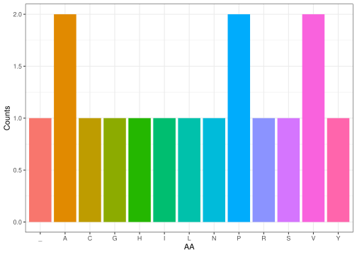

<!-- README.md is generated from README.Rmd. Please edit that file -->

# group28package

<!-- badges: start -->
<!-- badges: end -->

The goal of group28package is to provide simple functions around the
central dogma.

## Installation

You can install the development version of group28package from
[GitHub](https://github.com/) with:

``` r
# install.packages("pak")
pak::pak("rforbiodatascience26/group_28_package")
```

``` r
library("group28package")
```

Our package consists of five functions that work together to carry out
biology’s central dogma: from DNA to RNA, then to translation. The aim
is to abstract the underlying biology and provide user-friendly
functions that mimic these processes.

Our package requires the following dependencies: *ggplot2, stringr.* We
limited dependencies to the necessary ones, as including many makes the
package more susceptible to changes in dependency behaviour.

## Package functions

``` r
dna_seq = random_dna(seq_length = 50)
dna_seq
#> [1] "AACCATTACGGCAGATGTGTCCCAGCCCTTTAGATAGCTGTTCCCTCACG"
```

The first function, *random_dna()*, generates a random DNA sequence of a
specified length *seq_length*. In the example, it will generate a
sequence of 100 nucleotides (string of 100 chr).

Specifically, It randomly samples the four nucleotide bases (A, T, G, C)
with replacement and concatenates them into a single continuous string.

``` r
rna_seq = t_transcribe(dna = dna_seq)
rna_seq
#> [1] "AACCAUUACGGCAGAUGUGUCCCAGCCCUUUAGAUAGCUGUUCCCUCACG"
```

The second function, *t_transcribe()*, carries out transcription: it
converts a provided DNA sequence into its corresponding RNA transcript
by changing every “T” (Thymine) in the sequence with a “U” (Uracil). A
new string is returned.

``` r
rna_seq_codons = make_codons(sequence = rna_seq, start = 1)
```

The third function, *make_codons()*, is an intermediate function that
takes a given RNA sequence (string) and divides it into groups of three
starting from the specified position. The output is a vector of triplets
(codons) ready for translation.

``` r
protein_seq = codons_to_peptide(codons_vec = rna_seq_codons)
protein_seq
#> [1] "NHYGRCVPAL_IAVPS"
```

The fourth function, *codons_to_peptide()*, carries out the biological
step of translation. It reads in input a character vector of the codons
of the RNA sequence and converts each codon into its corresponding amino
acid residue (AA), generating a peptide sequence.

Note: such a peptide/protein sequence is not biologically accurate, as a
stop codon will not trigger a translation stop.

``` r
AA_frequency_barplot(protein_sequence = protein_seq)
```



The fifth function, *AA_frequency_barplot()*, takes a protein sequence
(string) and returns a *ggplot* barplot with the absolute frequencies
(counts) of each AA present in the sequence.

## Discussion and Future Directions

Our package is ideal for working with DNA, RNA, or protein sequences in
simple settings. For example, PCR results could be easily translated
into peptides to explore their properties as proteins. Or, a researcher
working with a DNA sequence, known to be expressed, might want to
analyse the resulting protein and quickly check the amino acid counts in
the sequence.

The functions are built to let users pipe them into a single workflow.

In the future, we could extend the central dogma by modelling
complementation, reverse complementation, reverse transcription, etc. It
might also be useful to add new functions to analyse the resulting
peptide sequences. For example, functions to calculate the molecular
weight, determine the isoelectric point (pI), or evaluate the
hydrophobicity index, which are essential metrics for characterising
protein behaviour in the laboratory and also provide great insight along
with the barplot.
